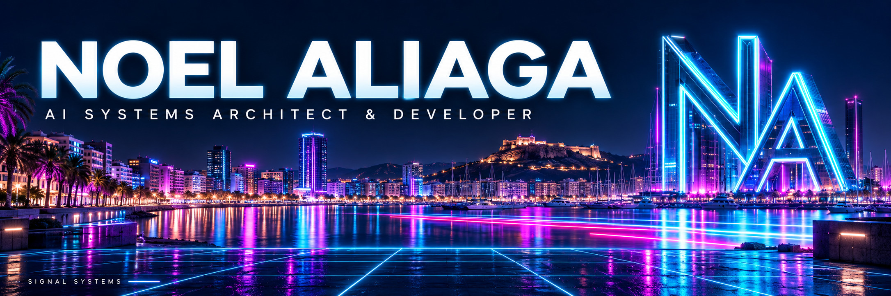
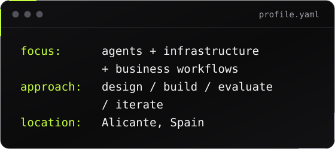
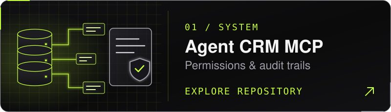
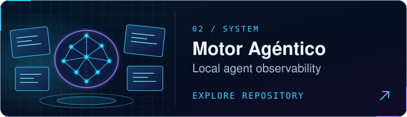
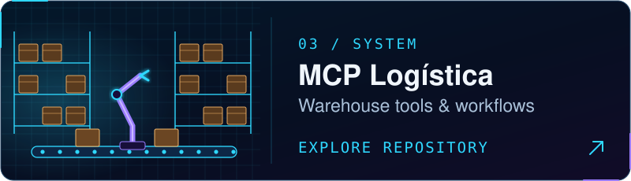
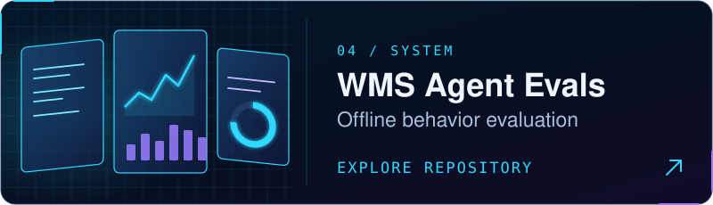

&nbsp;
&nbsp;

## <picture><source media="(prefers-color-scheme: light)" srcset="assets/h-about-light.svg" /></picture>

I design and build agent systems, MCP tools and business workflows.

My background in factory and warehouse operations shapes how I build software: clear responsibilities, controlled changes, useful checks and recovery when something fails.

I use Claude Code, Codex and other AI tools to implement my ideas while deepening my software engineering skills. My focus is problem definition, system design, orchestration, testing and iteration.

## <picture><source media="(prefers-color-scheme: light)" srcset="assets/h-toolkit-light.svg" /></picture>

<b>Agent orchestration · Evaluation</b>

## <picture><source media="(prefers-color-scheme: light)" srcset="assets/h-systems-light.svg" /></picture>

Restricted CRM tools, Postgres permissions and audit logging.

Read-only local dashboard. Public demo uses synthetic data.

Orders and stock tools with constrained writes and audit trails.

Tool calls, ambiguity and database effects. Published runs are synthetic.

These repositories are separate components and experiments at different stages of maturity. They are not a single production-ready platform. Each repository documents its evidence and limitations.

<b>More systems & developer tools</b>

- [Multiverso Context Engine](https://github.com/noelaliaga/multiverso-context-engine) — persistent project context and a navigable filesystem graph.
- [ADK WMS Assistant](https://github.com/noelaliaga/adk-wms-assistant) — Google ADK with WMS tools, read/write paths, human approval and telemetry. Tested offline; not deployed.
- [Content Engine Multiagent](https://github.com/noelaliaga/content-engine-multiagent) — five-stage content workflow with JSON Schema contracts and QA gates; fictional offline demo.
- [AI Guides](https://github.com/noelaliaga/guias-ia) — practical lessons on Git, reviews, security and deployment. [Read in Spanish](https://guias-ia.vercel.app).
- [HTML to Slides](https://github.com/noelaliaga/html-to-slides) — HTML carousels exported as Instagram-ready PNGs.

## <picture><source media="(prefers-color-scheme: light)" srcset="assets/h-principles-light.svg" /></picture>

| Principle | In practice |
| --- | --- |
| Explicit permissions | Bound tools and database writes. Clarify ambiguous targets. |
| Observable behavior | Record tool calls, state changes, failures and costs. |
| Independent review | Verify a fixed commit against the original requirements. |
| Honest evaluation | Separate synthetic demos, offline tests, live use and production. |
| Durable context | Preserve decisions and handoffs so work can resume. |

## <picture><source media="(prefers-color-scheme: light)" srcset="assets/h-public-light.svg" /></picture>

Currently developing a private **agent harness** focused on task ownership, independent review, durable handoffs, recovery, permissions and evaluations. Public repositories document individual components and experiments.

Also redesigning Motor Agéntico to make roles, memory, evidence and costs easier to inspect. New controls are a design goal; the current public dashboard remains read-only.

[View my actual GitHub activity →](https://github.com/noelaliaga)

<a href="https://www.linkedin.com/in/noelaliaga">Let's connect</a> · <a href="https://signalsystems.es">Signal Systems</a>

