<!-- Generado con signal-videos/perfil-github/generar.py desde datos.json (2026-10-31). No editar a mano. -->



Five years as a production lead in a factory, and a warehouse before that. That is where my systems come from: clear responsibilities, controlled changes, useful checks and a way to recover when something fails. Now I design and build AI agent systems with the same rules.


<b>1,238</b> commits across my repositories, public and private (human + AI co-authored), 2026-07-26 to 2026-10-31. My public GitHub graph is a separate count: 115 contributions in the last year.


Python · TypeScript · JavaScript · Swift · PostgreSQL · SQLite · Supabase · Next.js · Astro · Vercel · MCP · Claude Code · Codex · Google ADK · LiteLLM · Git · GitHub Actions · Playwright · GSAP · ffmpeg


<a href="https://github.com/noelaliaga/agent-crm-mcp"></a>

<a href="https://github.com/noelaliaga/motor-agentico-observability"></a>

<a href="https://github.com/noelaliaga/mcp-logistica"></a>

<a href="https://github.com/noelaliaga/wms-agent-evals"></a>

<a href="https://github.com/noelaliaga/adk-wms-assistant"></a>
<a href="https://github.com/noelaliaga/content-engine-multiagent"></a>

<a href="https://github.com/noelaliaga/multiverso-context-engine"></a>
<a href="https://github.com/noelaliaga/guias-ia"></a>

<a href="https://github.com/noelaliaga/html-to-slides"></a>
<a href="https://github.com/noelaliaga?tab=repositories"></a>






<a href="https://signalsystems.es"></a>



<b>Explicit permissions</b>: Agents only touch what they are allowed to. · <b>Observable behavior</b>: Every action leaves a trail you can read. · <b>Independent review</b>: Whoever writes the work does not approve it. · <b>Honest evaluation</b>: Tests that can fail, reported as they are. · <b>Durable context</b>: Memory and handoffs that outlive the session.

<b>Note.</b> Repositories are separate components and experiments at different stages of maturity, not a single production-ready platform.

<a href="https://github.com/noelaliaga">GitHub</a> · <a href="https://www.linkedin.com/in/noelaliaga">LinkedIn</a> · <a href="https://signalsystems.es">signalsystems.es</a> · <a href="https://www.instagram.com/noelaliaga_">Instagram @noelaliaga_</a>

